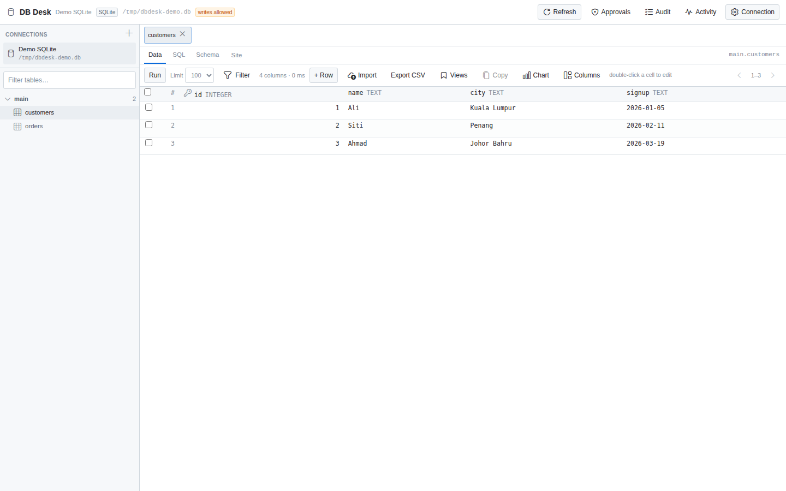

# DB Desk — standalone

A TablePlus-style database browser for **PostgreSQL, MySQL/MariaDB, ClickHouse
and SQLite** that runs on your Mac without Hermes.



This repository is the standalone packaging of the DB Desk Hermes plugin
([wzul/dbdesk](https://github.com/wzul/dbdesk)): the same page and the same
backend adapters, wrapped in a small Tauri shell with a Python sidecar.

```
┌──────────────────────────────┐
│ Tauri (Rust)                 │
│  · spawns the sidecar        │
│  · opens a native window     │
│         │                    │
│         ▼                    │
│ http://127.0.0.1:<random>    │
│  ┌────────────────────────┐  │
│  │ Python sidecar         │  │
│  │  · FastAPI /api/*      │  │
│  │  · serves the built UI │  │
│  │  · psql / mysql / HTTP │  │
│  │  · stdlib sqlite3      │  │
│  └────────────────────────┘  │
└──────────────────────────────┘
```

The server binds to `127.0.0.1` only. Credentials are encrypted at rest with
AES-GCM in the app-data directory (see *Data* below) and are never returned to
the UI.

## Run from source

```bash
# dependencies
make install            # root npm, ui npm, backend pip

# build the page and start the server (opens http://127.0.0.1:8765)
make server

# or run the desktop shell in development (spawns the Python server itself)
npm run app
```

`npm run app` needs Rust and the Tauri system dependencies. On macOS that is
Xcode Command Line Tools; on Linux see the Tauri prerequisites.

### UI-only development

```bash
python backend/app.py              # terminal 1 — API on :8765
npm --prefix ui run dev            # terminal 2 — Vite on :5173, proxies /api
```

## Build the macOS app

```bash
make sidecar        # PyInstaller one-file server -> src-tauri/binaries/
npm --prefix ui run build
npm run tauri build # -> src-tauri/target/release/bundle/dmg/*.dmg
```

`externalBin` in `src-tauri/tauri.conf.json` tells Tauri to place the sidecar
next to the main executable inside `DB Desk.app/Contents/MacOS/dbdesk-server`.
The Rust shell starts it on a free localhost port, waits until it accepts
connections, then opens a window pointed at it. The child is killed on exit.

The GitHub Actions workflow builds both architectures on every push:

- `macos-13` → `x86_64-apple-darwin` (Intel)
- `macos-14` → `aarch64-apple-darwin` (Apple Silicon)

Unsigned DMGs run after a right-click → **Open**. For distribution, add the
usual signing/notarization secrets (`APPLE_CERTIFICATE`,
`APPLE_CERTIFICATE_PASSWORD`, `APPLE_SIGNING_IDENTITY`, `APPLE_ID`,
`APPLE_PASSWORD`, `APPLE_TEAM_ID`); Tauri picks them up automatically.

## Data

| Platform | Location |
|---|---|
| macOS | `~/Library/Application Support/DB Desk/data` |
| Linux | `~/.local/share/dbdesk/data` (`$XDG_DATA_HOME`) |
| Windows | `%APPDATA%\DB Desk\data` |

Set `DBDESK_HOME` to override. The directory contains:

- `connections.json` — connections, passwords AES-GCM encrypted
- `vault.key` — the 32-byte key (0600)
- `audit.jsonl`, `approvals.json`, `queries.json`, `views.json`

## What works

Everything the plugin page does:

- connections (Postgres, MySQL/MariaDB, ClickHouse, SQLite) with SSH tunnels,
  custom tunnel commands, MCP query tools and HTTP gateways
- schema tree, typed data grid, inline editing, filters, tabs, saved views
- SQL runner, autocomplete, formatter, history, saved queries, charts
- schema DDL, cross-connection diff, add/drop/rename column, index editor
- CSV import and whole-table export
- serialized-PHP tools and the WordPress Site tab
- read-only guard, production approvals and the write audit log
- Activity drawer

Notes for the standalone build:

- **Telegram notices are off** unless `DBDESK_NOTIFY=1` and a `hermes` CLI is on
  PATH. Production approvals still work — approve them in the **Approvals**
  drawer.
- **MCP connections** need a Hermes runtime; they are listed but cannot run
  queries here. HTTP gateways work normally.
- SQLite needs the file on this machine (no upload).

## Tests

```bash
npm --prefix ui run build
python -m unittest discover -s tests -v
```

The smoke test drives the real FastAPI app with an in-memory/temporary SQLite
database, so no server is required.

## Layout

```
backend/app.py            FastAPI app: /api/* + static UI + /health
backend/dbdesk_api.py     adapters (standalone copy of the plugin backend)
backend/dbdesk-server.spec PyInstaller one-file build
ui/src/plugin.js          DB Desk page (same file as the Hermes plugin)
ui/src/sdk-shim.jsx       the few Hermes SDK pieces the page imports
ui/src/main.jsx           mounts the page, toasts, light/dark
src-tauri/                Tauri v2 shell, config, icons, capabilities
scripts/build-sidecar.sh  PyInstaller -> src-tauri/binaries/dbdesk-server-<triple>
tests/test_standalone.py  server smoke tests
```

`ui/src/plugin.js` and `backend/dbdesk_api.py` are copies; the sync script
refreshes them from a local Hermes checkout:

```bash
scripts/sync-plugin.sh /path/to/.hermes/plugins/dbdesk
```

## Security

DB Desk executes SQL with the credentials you configure, and a custom tunnel
command is a shell command you supply. Treat a connection as code execution on
this machine. Read-only is the default and enforced by the backend, but it is a
guardrail, not a sandbox.

## License

MIT.
