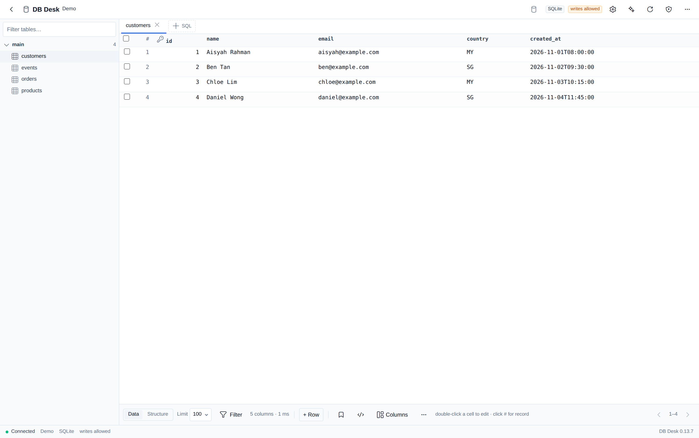
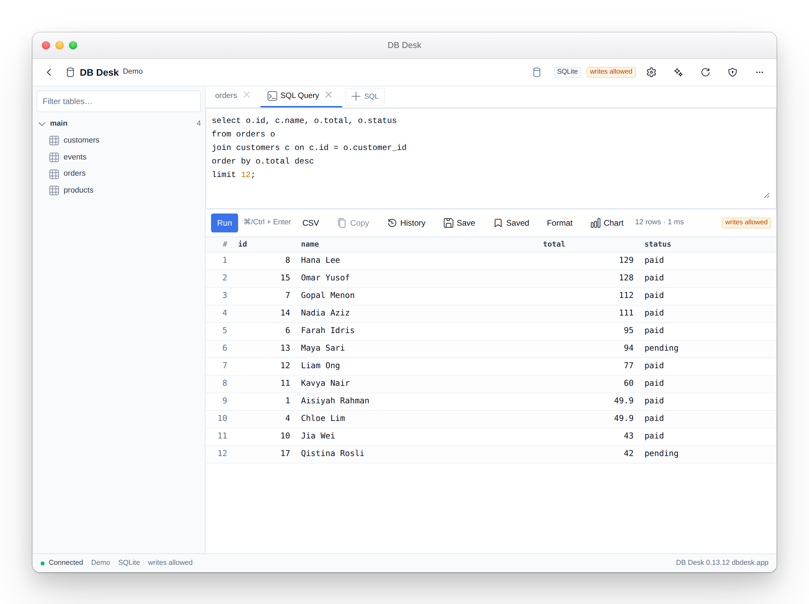

# Features

[← Back to the README](../README.md)

- **MCP server for local agents** — Settings → **MCP server** exposes DB Desk
  to Claude Desktop, Cursor, Hermes or any MCP client over stdio or loopback
  HTTP. Tools cover connections, databases, tables, columns, indexes, DDL,
  rows, CSV, SQL and the AI agent. Disabled by default; one toggle generates a
  bearer token.
- **Keyboard shortcuts** — **⌘F** filter/search, **⌘R** refresh, **⌘⏎** run,
  **⌘S** save SQL, **⌘2 / ⌘T** new SQL tab, **⌘1 / 3 / 4** Data/Structure/Site,
  **⌘+ / ⌘− / ⌘0** zoom,
  **⌘/** shortcut list, **⌘,** settings.
- **Remembers window size and position** across launches (saved to
  `window.json` in the app data folder); if the monitor is gone, the app falls
  back to the default size instead of opening off-screen.
- **Settings (⌘,)** — one preferences window: **Appearance** (System / Light /
  Dark), updates, native notification toggle + test, MCP server, AI provider
  (base URL/model/key), backup & restore, application-data path and version.
  Open it with **⌘,**, the gear on the picker, or the gear in the app header.
- **AI setup assistant** — **AI setup** on the picker: describe the database
  (“MySQL on my VPS behind a bastion”) and the agent returns a field-by-field
  draft; **Use this setup** opens the form prefilled. Passwords are never sent:
  the draft is sanitized server-side and the form leaves the password blank.
- **Ask AI (read-only)** — the header **AI** button opens a prompt bar. It sends
  the current table/column names and your question to an OpenAI-compatible
  endpoint (OpenAI, OpenRouter, Ollama, LM Studio, ...), receives one SELECT,
  runs it read-only and shows the SQL and rows. The panel is a **chat**: press
  Enter, read the result, then type a follow-up (“pecahkan ikut bulan”) and the
  previous SQL/answers are carried into the next request. If a statement fails
  (for example a wrong column name), the error and the relevant schema are sent
  back once so the model can correct the query. Server-side rules refuse any non-read
  statement. Configure base URL, model and API key under the AI
  settings; the key is encrypted at rest and row data is never sent.
- **Multi-database agent** — the AI scope bar defaults to every AI-enabled
  connection. When a question spans databases (“who is in app-db but not the
  warehouse?”) the agent first requests the missing schemas, then returns one
  read-only statement per database plus a join. DB Desk runs each statement
  against its own database, loads the result sets into an in-memory SQLite
  database and executes the join **locally**. Only schema names, SQL, row
  counts and error text go to the provider — never the rows. Each answer shows
  the per-source SQL (copy, or open in SQL when it is the current connection),
  the local join, the merged table and a short step log.
- **Per-connection AI switches** — in the connection form, turn off **AI can
  see this schema** to hide a database from the agent entirely, or turn off
  **AI can run read-only queries** to keep it inspect-only. Statements run by
  the agent are written to the audit log.
- **Docked AI and record panels** — the AI chat opens on the right without
  covering the grid; clicking a row number opens a TablePlus-style **Record**
  panel on the right with each column name, type and value.
- **New connection type cards** — the connection form shows real logos for
  PostgreSQL, MySQL, MariaDB, ClickHouse, MongoDB, Redis, SQLite, MCP and HTTP;
  choosing a card sets the default port. MariaDB is stored as MySQL with a
  `mariadb` flavor. MongoDB has SRV and auth-source options; Redis has a
  database index.
- **MongoDB document browser** — collections appear in the tree; the data grid
  pages documents, the filter panel accepts column filters or a raw Mongo
  filter object (`{"age": {"$gt": 18}}`), and the Query tab runs JSON commands
  (`{"collection": "users", "find": {...}, "sort": {...}, "limit": 50}` or
  `aggregate`). Double-click a cell to edit a field, **+ Row** inserts a
  document, and row actions delete. Nested objects/arrays show as compact JSON.
  Reads use the sampled field list; production writes go through the approval
  drawer.
- **Redis / Valkey browser** — the tree lists the logical databases, the grid
  scans keys (`key`, `type`, `ttl`, `size`) with a `MATCH` pattern filter, and
  clicking a key opens a value drawer for strings, hashes, lists, sets, sorted
  sets and streams. The **Console** tab runs any command (`GET`, `HGETALL`,
  `SCAN`, ...); read-only connections refuse writes, and production writes ask
  for approval first.
- **Connection picker** — the app opens on a TablePlus-style list: search,
  groups, type icons, read-only/PROD badges; pick a connection, then the full
  browser opens. Right-click a connection for **Open / Edit / Clone / Test /
  Export / Delete**; Clone duplicates the encrypted credentials too. **New connection** goes straight to the form, and the chevron
  in the header returns to the list.
- **Connection rail** — when more than one connection is open, a slim rail
  appears on the left. Right-click an icon for **Open / Edit connection / Close
  connection / Close other connections / Close all connections**. With a
  single connection open the rail hides itself.
- **Resume last connection** — after you click the back chevron (or relaunch
  the app), the picker shows a **Continue where you left off** banner for the
  last connection you opened. One click returns to that explorer.
- **Import / export & QR** — export one connection from the share icon or all of
  them from the picker as a `.dbdesk` bundle. Passwords are left out by default;
  tick **Include passwords** to encrypt them with a passphrase (scrypt +
  AES-GCM). Import accepts a file, pasted bundle or `dbdesk://` link, shows a
  preview, then merges with new ids. **Show QR** renders a scannable code for a
  single connection (QR capacity is limited, so large bundles fall back to the
  file/copy).
- **Backup & restore (migration)** — Settings → **Backup all** writes one file
  with every connection, saved view and saved query. Passwords are optional and
  encrypted (scrypt + AES-GCM). On the new Mac, **Restore** previews the file,
  creates the connections, remaps views/queries to the new ids and leaves
  passwords blank when they were not included.
- **Structure grid** — the Structure tab (bottom switcher) shows a TablePlus-style structure
  grid: `#`, column, data type, character set, collation, nullable, default,
  extra (auto-increment/identity), foreign key and comment, plus an index grid
  (`index_name`, algorithm, unique, column). DDL is still available from the
  **DDL** button but no longer the default view.
- **SQL query tabs** — **SQL** (or **⌘T**) opens a dedicated query tab next to
  the table tabs. Each tab keeps its own SQL text and result set, so a second
  query does not overwrite the first; close a tab when you are done.
- **Bottom data toolbar** — Run, Limit, Filter, row metadata, view/SQL/column
  actions, More menu and pagination sit under the grid, like TablePlus.
- **TablePlus-style filters** — each row has a checkbox, a **Raw SQL / column**
  picker, a full-width pattern, **Apply**, **−** and **+**. Raw SQL rows append
  a WHERE expression; column rows keep the operator/value controls. **Apply
  all** enables every valid row, **Clear** unapplies the filters but keeps
  their values (press Apply to re-enable), and **SQL** turns the active filters
  into a SELECT. Saved views keep the flags.
- **Flexible export** — export the current table as **CSV**, **JSON** or **SQL
  INSERTs** from the table right-click menu or the **More** menu. The export
  respects the active filters and sort and caps at 50k rows (200k server cap).
- **Quick panel (⌘P / Ctrl+P)** — jump to a table, view, schema, function or
  connection, or run actions such as **New SQL tab**, **Toggle theme**,
  **Settings** and **Close connection**. Arrow keys + Enter work.
- **SQL editor** — syntax highlighting for keywords, strings, numbers, comments
  and function calls. Autocomplete is **alias-aware** (`c.` lists the columns of
  the table aliased `c`), knows every table referenced in `FROM`/`JOIN`, includes
  table names, columns and functions, and supports fuzzy matching with a source
  label. `⌘Space` / `Ctrl+Space` opens the list manually; `↑`/`↓` + `Tab`/`Enter`
  accepts.
- **JSON editor** — double-click a JSON/JSONB cell for a large modal with
  **Format**, **NULL**, Cancel and Save; invalid JSON is rejected.
- **Saved query buttons** — the SQL toolbar has **Save** (name + current SQL)
  and **Saved** (opens the snippet list); the same snippets are available to the
  MCP agent through `queries_list` / `query_save` / `query_delete`.
- Everything the plugin page does:

- connections (Postgres, MySQL/MariaDB, ClickHouse, SQLite, MongoDB,
  Redis/Valkey) with SSH tunnels, custom tunnel commands, MCP query tools and
  HTTP gateways
- schema tree, typed data grid, inline editing, filters, tabs, saved views
- SQL runner, autocomplete, formatter, history, saved queries, charts
- structure grid (columns + indexes) with on-demand DDL, cross-connection diff,
  add/drop/rename column, index editor
- CSV import and whole-table export
- serialized-PHP tools and the WordPress Site tab
- read-only guard, production approvals and the write audit log
- Activity drawer

Notes for the standalone build:

- **Native macOS notifications** — approval requests and production writes show
  a system notification while the app is running. Nothing is sent to Telegram or
  any external service. Approve writes in the **Approvals** drawer; test with
  **Settings → Notifications → Test**.
  Because the build is ad-hoc signed (no Apple Developer ID), macOS ties the
  notification permission to the current signature and drops it after every
  update. Open **System Settings → Notifications → DB Desk**, enable it and
  choose **Alerts**; the Settings panel has a shortcut plus diagnostics. The
  **Fallback** test posts through Script Editor for setups where native delivery
  still fails. With a Developer ID build the permission survives updates.
- **MCP connections work directly.** Add the streamable-HTTP endpoint
  (e.g. `https://mcp.example.com/mcp`), the tool name and SQL argument,
  then **Authorize**: DB Desk runs OAuth 2.1 with PKCE through a loopback
  redirect, opens the system browser, stores the tokens encrypted and refreshes
  them automatically. No token pasting. Unauthenticated MCP servers also work;
  Hermes-style named MCP servers still work in the plugin.
- SQLite needs the file on this machine (no upload).
