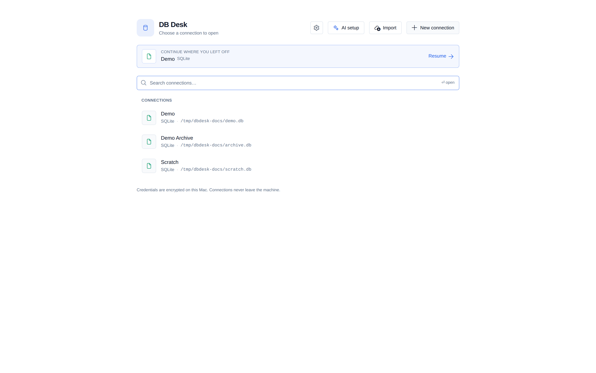

# Getting started

[← Back to the README](../README.md)



## Requirements

- **Node.js 26 LTS** (or any 22.12+; the repo ships `.nvmrc`)
- **Python 3.11+**
- **Rust stable** (1.77+) and Xcode Command Line Tools on macOS
- `psql` and/or `mysql` clients for those connection types (SQLite uses the
  Python standard library)

The server binds to `127.0.0.1` only. Credentials are encrypted at rest with
AES-GCM in the app-data directory (see *Data* below) and are never returned to
the UI.

## Run from source

```bash
# dependencies
make install            # root npm, ui npm, backend pip

# build the page and start the server (opens http://127.0.0.1:8765)
make server

# or run the desktop shell in development (spawns the Python server itself)
npm run app
```

`npm run app` needs Rust and the Tauri system dependencies. On macOS that is
Xcode Command Line Tools; on Linux see the Tauri prerequisites.

### UI-only development

```bash
python backend/app.py              # terminal 1 — API on :8765
npm --prefix ui run dev            # terminal 2 — Vite on :5173, proxies /api
```

## Build the macOS app

```bash
make sidecar        # PyInstaller one-file server -> src-tauri/binaries/
npm --prefix ui run build
npm run tauri build # -> src-tauri/target/release/bundle/dmg/*.dmg
```

The sidecar is a PyInstaller **onedir** tree (no unpack on launch). Tauri ships
it as a bundle resource, so it lands in
`DB Desk.app/Contents/Resources/sidecar/dbdesk-server/`. The Rust shell shows a
splash window immediately, starts the sidecar on a free localhost port, waits
until it accepts connections, then navigates the same window to it. The child is
killed on exit. The splash is `ui/public/splash.html`.

The GitHub Actions workflow builds both architectures on every push:

- `macos-13` → `x86_64-apple-darwin` (Intel)
- `macos-14` → `aarch64-apple-darwin` (Apple Silicon)

Unsigned DMGs run after a right-click → **Open**. For distribution, add the
usual signing/notarization secrets (`APPLE_CERTIFICATE`,
`APPLE_CERTIFICATE_PASSWORD`, `APPLE_SIGNING_IDENTITY`, `APPLE_ID`,
`APPLE_PASSWORD`, `APPLE_TEAM_ID`); Tauri picks them up automatically.

## Updates

The app checks GitHub Releases for a signed update manifest when it opens.
When a newer version exists, the picker shows **Update available — vX**;
**Update now** downloads the `.app.tar.gz`, verifies the minisign signature,
replaces the bundle and relaunches.

- No Apple Developer account is involved: the updater uses its own minisign
  keypair. The public key is in `src-tauri/tauri.conf.json`; the private key
  lives only in the `TAURI_SIGNING_PRIVATE_KEY` CI secret.
- Releases are published by `.github/workflows/release.yml` when a `v*` tag is
  pushed; it reuses the successful `main` build and writes `latest.json`.
- The first build with the updater (0.7.1) must be installed manually once;
  later versions update in place.
- Manifest URL:
  `https://github.com/wzul/dbdesk-app/releases/latest/download/latest.json`

## Data

| Platform | Location |
|---|---|
| macOS | `~/Library/Application Support/DB Desk/data` |
| Linux | `~/.local/share/dbdesk/data` (`$XDG_DATA_HOME`) |
| Windows | `%APPDATA%\DB Desk\data` |

Set `DBDESK_HOME` to override. The directory contains:

- `connections.json` — connections, passwords AES-GCM encrypted
- `vault.key` — the 32-byte key (0600)
- `audit.jsonl`, `approvals.json`, `queries.json`, `views.json`
