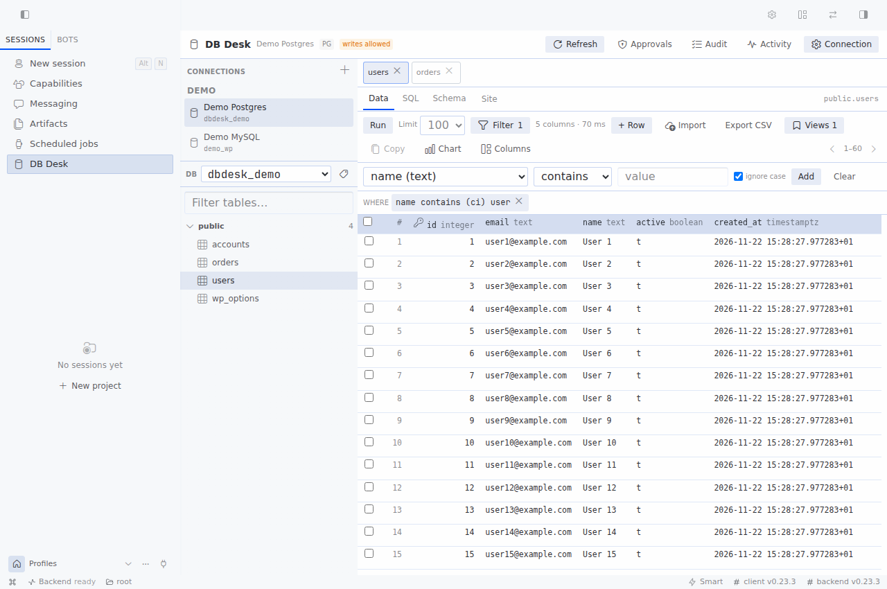

# DB Desk

A TablePlus-style database browser that runs inside **Hermes** — PostgreSQL,
MySQL/MariaDB, ClickHouse, SQLite, MongoDB and Redis/Valkey, plus MCP servers
and HTTP query gateways (including Cloudflare Zero Trust). Connections, a schema tree, typed inline editing, a SQL
runner, CSV import/export, saved views, schema diff/index tools and a full audit
log, all from the Hermes Desktop/Webapp.

Home page: **dbdesk.app**.



## Beyond TablePlus

DB Desk keeps the TablePlus workflow — connections, schema tree, data grid,
tabs, filters, SQL runner — and adds three things you normally need a second
tool for:

- **Encrypted columns, revealed in place.** Save an AES key per connection
  (raw key, `base64:` Laravel `APP_KEY`, or passphrase), list the encrypted
  columns, and DB Desk decrypts Laravel and `{"p": …, "h": {"iv": …}}`
  envelopes into the grid (AES-256-GCM / AES-256-CBC, auto-detected). Toggle
  reveal/hide without a single `pgp_sym_decrypt` call. The key is AES-GCM
  encrypted at rest, never returned by the API, and never sent to the AI.
- **Timezone-aware browsing.** Pick a display timezone (`Asia/Kuala_Lumpur`)
  and how naive timestamps are stored (`UTC` by default). `timestamp without
  time zone` and `timestamptz` values render in your timezone, and column
  filter values are converted back to the storage timezone, so searching
  `2026-11-24 09:00` just works.
- **NoSQL next to SQL.** MongoDB collections/documents and Redis/Valkey keys,
  value drawer and command console share the same window, read-only guards,
  production approvals and audit log.

## Features

- **Connections** — PostgreSQL, MySQL/MariaDB, ClickHouse, **SQLite** (a local
  `.db` file, read-only via `mode=ro`), **MongoDB** (SRV, auth source),
  **Redis/Valkey** (database index), **MCP query tools** and **HTTP query
  gateways**; optional **SSH tunnel** or **custom tunnel command** (SSM port
  forwarding, `cloudflared access tcp`, ...).
- **MongoDB** — collection tree, document grid, JSON filter/query, inline field
  editing, insert/delete, indexes and sampled field types; production writes
  ask for approval.
- **Redis/Valkey** — logical-database tree, key browser (key/type/ttl/size),
  value drawer for strings, hashes, lists, sets, sorted sets and streams, and a
  command console. Read-only connections refuse writes; production writes ask
  for approval.
- **Optional drivers** — `pip install pymongo redis` enables MongoDB and Redis
  (the standalone app bundles them). Without them the SQL adapters keep
  working and the new kinds show a clear install message.
- **Secrets** — passwords encrypted with AES-GCM; key in `vault.key` (0600);
  never returned to the UI. Custom tunnel env and HTTP headers stay in the
  0600 connection store.
- **Schema tree & DB switcher** — groups, per-database labels (optional
  WordPress `siteurl` auto-detect), table filter.
- **Data grid** — tabs, typed inline editors (boolean/number/JSON), insert,
  duplicate-free NULL handling, row detail, column show/hide, virtualized rows,
  Load more, copy/multi-select, row filters with case-insensitive `contains`.
- **Safety** — read-only by default; every write shows the exact SQL; production
  connections require an explicit confirmation **and approval** (Telegram notice
  + Approvals drawer); sensitive WordPress tables get an extra warning; every
  write is audited (`audit.jsonl`, 0600).
- **SQL tabs** — each query opens its own tab with independent text and
  results (⌘2 / ⌘T), like TablePlus.
- **SQL** — autocomplete (keywords, tables, referenced tables' columns),
  formatter, history, saved queries, CSV, SVG bar/line charts.
- **Schema** — DDL view (`\d+`, `SHOW CREATE TABLE`, `sqlite_master.sql`),
  cross-connection column diff, add/drop/rename column, index create/drop, all
  through the SQL preview/approval flow.
- **CSV** — import (preview + approval, 5000 rows) and whole-table export
  (server-side, 50k cap).
- **Serialized PHP** — detect, parse and fix `s:N` lengths in `wp_options`.
- **WordPress Site tab** — site URL, theme, active plugins, post/page/user
  counts.
- **Agent tools** — `db_connections` and `db_query` (read-only, 200 rows max)
  over the same connections, including SSH/custom tunnels.
- **Activity** — sessions/queries from `pg_stat_activity`,
  `information_schema.processlist` or `system.processes`.

See the illustrated **[user guide](docs/user-guide.md)**.

## Install

```bash
# from Git (pin a commit for reproducible installs)
hermes plugins install your-user/dbdesk --ref <40-char-sha>
hermes plugins enable dbdesk

# or copy this folder to:
#   ~/.hermes/plugins/dbdesk/
```

Then open **Capabilities → Plugins → DB Desk** and enable the UI half (the
desktop half is opt-in). The page appears in the sidebar (⌘K → *Open DB Desk*).

MCP connections are default-deny; grant a server:

```bash
hermes config set plugins.entries.dbdesk.mcp_allowlist '["my-postgres-mcp"]'
```

## Tests

```bash
./tests/run.sh
# or, without the Hermes runtime (needs fastapi + cryptography):
pip install fastapi cryptography
PYTHON=python ./tests/run.sh
```

51 backend/agent tests; no database server required (dialects mocked, temporary
`HERMES_HOME`, local HTTP mock). The desktop half is checked with
`node --check` in CI.

## Security

DB Desk executes SQL with the credentials you configure, and a **custom tunnel
command** is a shell command you supply (SSM, cloudflared, a bastion script).
Treat a connection as code execution on this host. Credentials are encrypted at
rest, but the plugin is a guardrail, not a sandbox. Read
[SECURITY.md](SECURITY.md) before enabling it on production databases.

## License

MIT — see [LICENSE](LICENSE).
