# DB Desk — Panduan Pengguna

DB Desk ialah browser database gaya TablePlus yang hidup **di dalam Hermes** —
satu page dalam sidebar Desktop/Webapp. Sokongan **PostgreSQL, MySQL/MariaDB,
ClickHouse dan SQLite**, dengan SSH tunnel, edit data, SQL runner, import/export
dan tools read-only untuk agent.

> Skrin di bawah diambil pada build semasa. UI mungkin berubah sedikit antara
> versi.

## 1. Pasang & buka

1. **Capabilities → Plugins → DB Desk** → hidupkan switch (UI half opt-in;
   agent half biasanya sudah enabled).
2. Buka **DB Desk** dalam sidebar, atau ⌘K → *Open DB Desk*.
3. Kalau page tak muncul selepas update: reload tab, atau ⌘K → **Reload
   desktop plugins**.

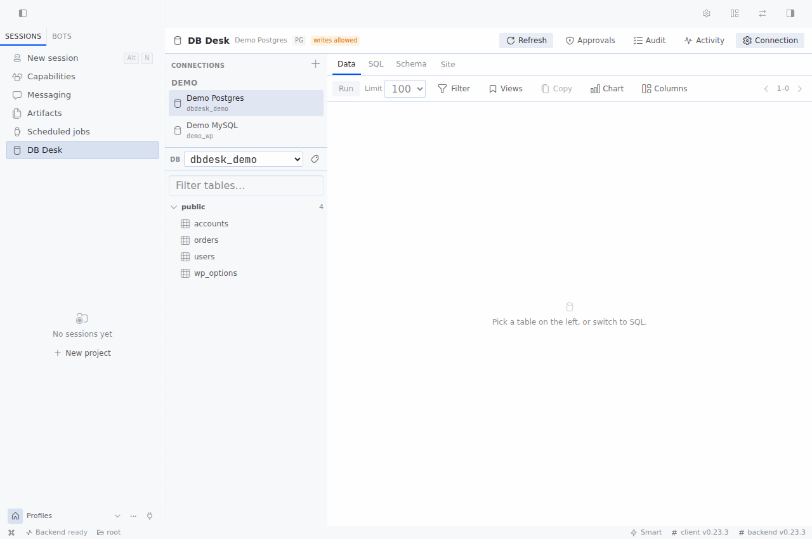

## 2. Connections

Klik **+** dalam bahagian CONNECTIONS (atau **Connection** di header).

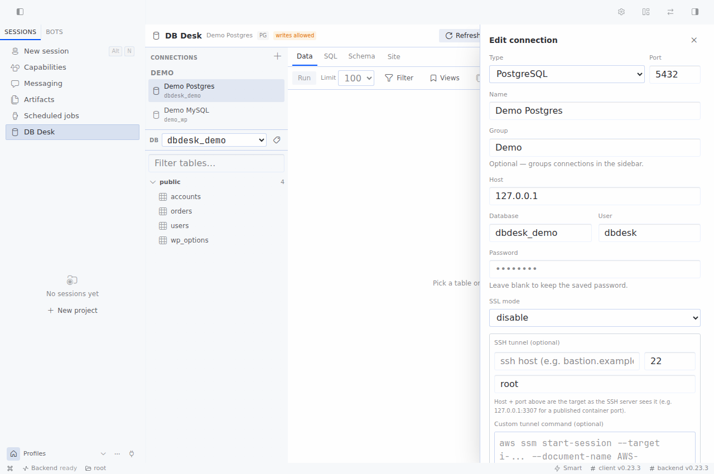

| Field | Nota |
|---|---|
| **Type** | PostgreSQL / MySQL-MariaDB / ClickHouse / SQLite (port auto: 5432 / 3306 / 8123) |
| **Database file** | Khusus SQLite — path penuh ke fail `.db`/`.sqlite` pada host Hermes (cth `/root/data/app.db`). Tiada host/port/SSH |
| **Name / Group** | Group optional — connections dikumpul dalam sidebar |
| **Host / Port** | Alamat DB. Dengan SSH tunnel, ini alamat **sebagaimana server SSH nampak** (cth `127.0.0.1:3307`) |
| **Database / User / Password** | Password disimpan encrypted; tak pernah dipulangkan ke UI |
| **SSH tunnel** | Host/user/port SSH (key auth). Tunnel diurus automatik (`ssh -N -L`) |
| **Custom tunnel command** | Command yang buka Host:Port (SSM/cloudflared). Override SSH bila diisi |
| **Read-only** | Default ON — backend refuse write |
| **Production** | Setiap write kena tick pengesahan tambahan |

**Test** sebelum Save. **Delete** untuk buang connection.

### Custom tunnel (VPC / SSM / Cloudflare TCP)

Kalau DB duduk dalam VPC, biar command buka local port dulu; isi **Host/Port**
sebagai `127.0.0.1:<local port>`.

AWS SSM:
```
aws ssm start-session --target i-0123456789abcdef0 \
  --document-name AWS-StartPortForwardingSessionToRemoteHost \
  --parameters '{"host":["db.internal"],"portNumber":["5432"],"localPortNumber":["15432"]}'
```

Cloudflare Access TCP:
```
cloudflared access tcp --hostname db.example.com --url 127.0.0.1:15432 \
  --service-token-id "$CF_ACCESS_CLIENT_ID" \
  --service-token-secret "$CF_ACCESS_CLIENT_SECRET"
```

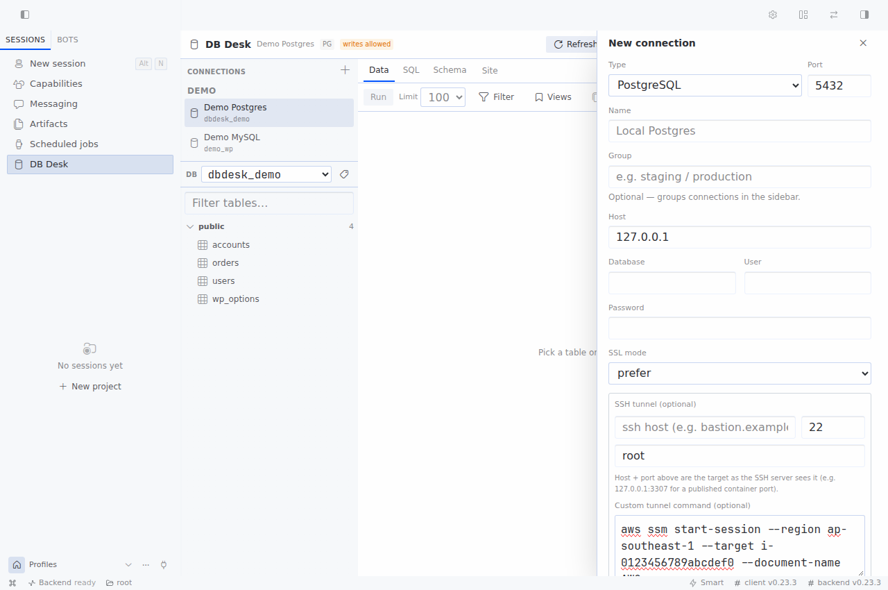

DB Desk tunggu port terbuka (timeout 25s default). Kalau command exit awal,
stderr dia dipaparkan.

**Contoh: RDS dalam VPC (SSM).** Andaikan RDS
`db.internal.example.com:5432` dicapai melalui bastion
`i-0123456789abcdef0`, dan SSM buka local port 15433:

| Field | Nilai |
|---|---|
| Host / Port | `127.0.0.1` / `15433` |
| Tunnel command | `aws ssm start-session --region ap-southeast-1 --target i-0123456789abcdef0 --document-name AWS-StartPortForwardingSessionToRemoteHost --parameters '{"host":["db.internal.example.com"],"portNumber":["5432"],"localPortNumber":["15433"]}'` |
| Tunnel env | `AWS_REGION=ap-southeast-1` + `AWS_PROFILE=default` (optional; host `~/.aws` pun boleh) |

Kalau app berjalan dalam Docker, SSM bind localhost sahaja; container lain
perlukan `socat` (atau publish port). DB Desk berjalan atas host, jadi terus
guna port yang `localPortNumber` buka.

### DB switcher & label

Bila connection ada lebih daripada satu database, dropdown **DB** muncul di
bawah senarai connection. Untuk MySQL/WordPress, klik icon 🏷️ → **Auto-detect
from WordPress** membaca `wp_options.siteurl` setiap DB dan isi label
(`example.com — demo_wp`). Label optional; kosong = guna nama DB.

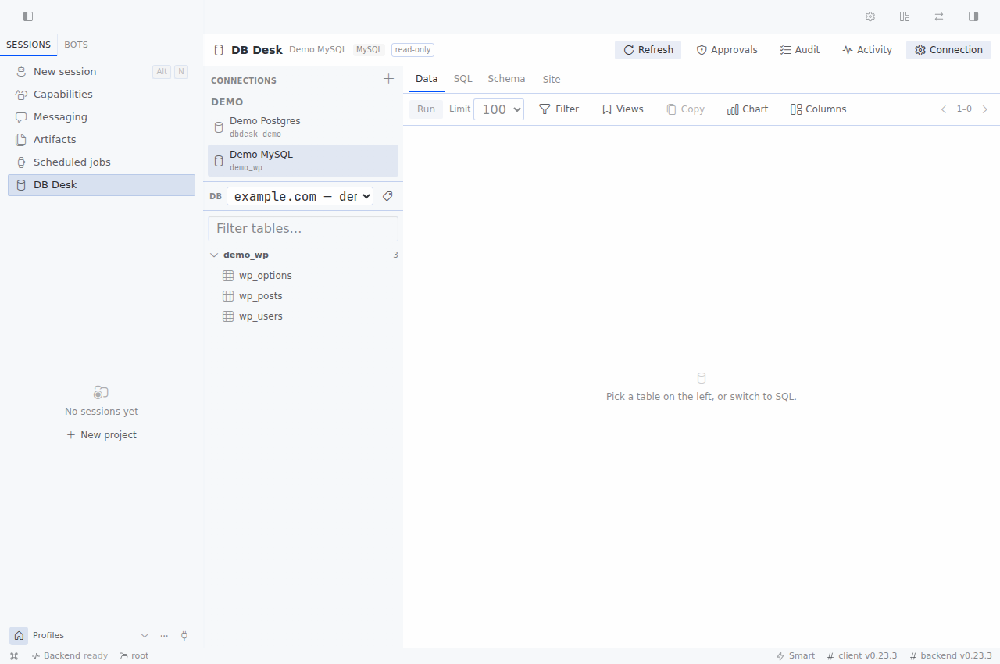

Kotak **Filter tables…** menapis nama table dalam tree.

## 3. Data grid

Klik table dalam tree.

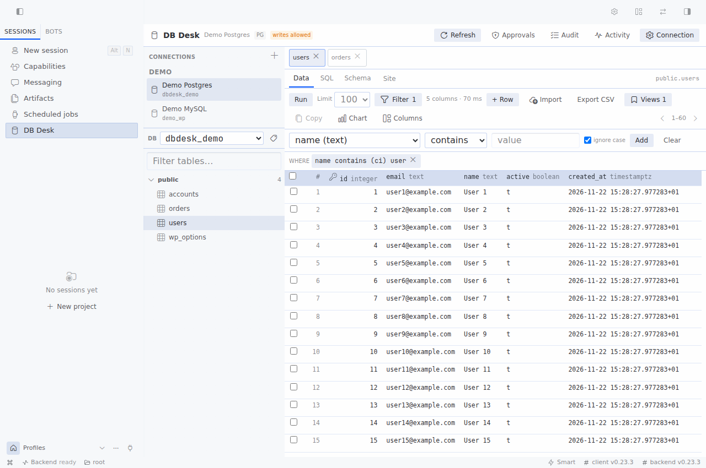

- **Tabs** — buka beberapa table serentak; setiap tab simpan filter/sort/limit
  sendiri. Tutup guna ×.
- **Sort** — klik header column. Default ikut primary/sorting key.
- **Filter** — bina `WHERE`: column, operator (`contains`, `=`, `≠`, `>`, `<`,
  `≥`, `≤`, `is null`, `is not null`), value. Untuk `contains`/`startswith` ada
  checkbox **ignore case** (default ON) — buka untuk match case. MySQL CI guna
  `LOWER(...) LIKE LOWER(...)` (tak bergantung pada collation). Banyak filter =
  AND; chip boleh dibuang.
- **Views** — simpan kombinasi filter + sort + limit dengan nama, apply semula
  satu klik.
- **Limit / Load more** — 50–500 row per page; *Load more* append page
  seterusnya (grid virtualized bila >200 row).
- **Copy** — pilih cell (shift-klik untuk range, klik nombor baris untuk satu
  baris), then Copy sebagai TSV / CSV / JSON / INSERT. `⌘/Ctrl+C` = TSV.
- **Edit** — double-click cell (desktop) atau long-press (mobile) → Edit.
  Editor ikut type: boolean dropdown, number, textarea JSON (dengan validasi),
  text. Butang **NULL** tulis null.
- **+ Row / Import** — insert satu row, atau import CSV.
- **Trash** — delete row (butang muncul bila hover).
- **Serialized-PHP guard** — value macam `a:1:{…}` tunjuk warning; jaga `s:N`
  length untuk WordPress.

Semua write melalui **preview SQL** + dialog Execute. Connection **PROD**
perlukan tick “I understand…” dan **approval** (lihat seksyen 7).

**Bulk rows:** checkbox di setiap baris + checkbox header (select all). Bila ada
baris dipilih, toolbar tunjuk **N selected**, **Delete selected** (max 500,
satu preview + approval) dan **Clear**. **Copy** akan guna baris yang dipilih.

## 4. SQL runner

Tab **SQL**.

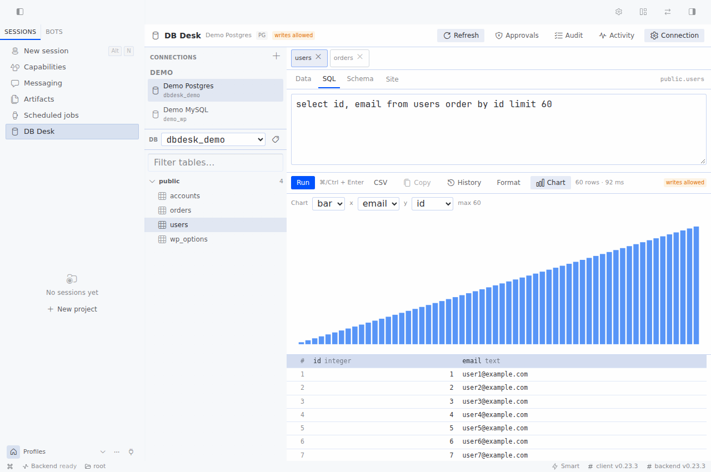

- **Autocomplete** — taip 2+ huruf; suggestion keyword, table, column table
  semasa dan table yang disebut dalam `FROM/JOIN/UPDATE/INTO`. `↑/↓`, Enter/Tab
  terima, `⌘/Ctrl+Space` buka semua.
- **Format** — uppercase keyword + newline sebelum clause.
- **Run** — `⌘/Ctrl+Enter`. Read-only connection hanya benarkan
  SELECT/WITH/SHOW/EXPLAIN.
- **History** — setiap run direkod (SQL, row, ms, error); klik untuk load.
  **Saved** — simpan query bernama.
- **CSV** — export result semasa.
- **Chart** — bar/line SVG, pilih column x/y (60 row pertama).
- **Copy** — sama seperti grid.

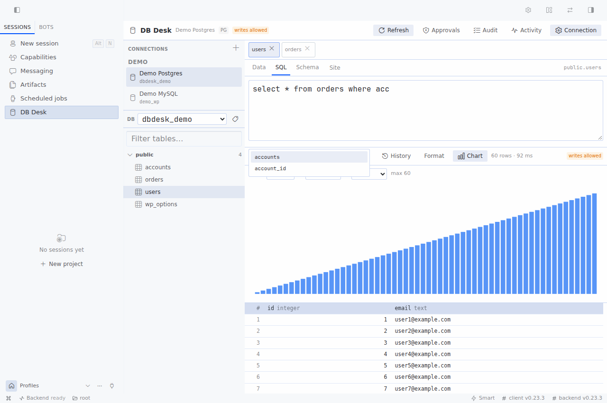

## 5. Schema

Tab **Schema** tunjuk DDL table: `\d+` untuk PostgreSQL, `SHOW CREATE TABLE`
untuk MySQL/ClickHouse, `sqlite_master.sql` untuk SQLite.

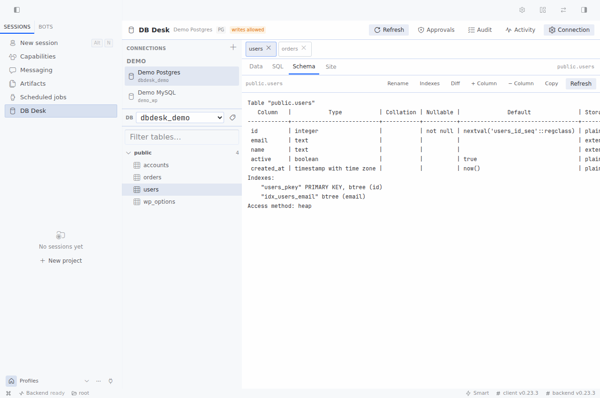

- **Diff** — banding table semasa dengan table lain, **dalam connection yang
  sama atau connection lain**. Status per column: `same`, `missing in target`,
  `only in target`, `type/nullability/key differs`.

  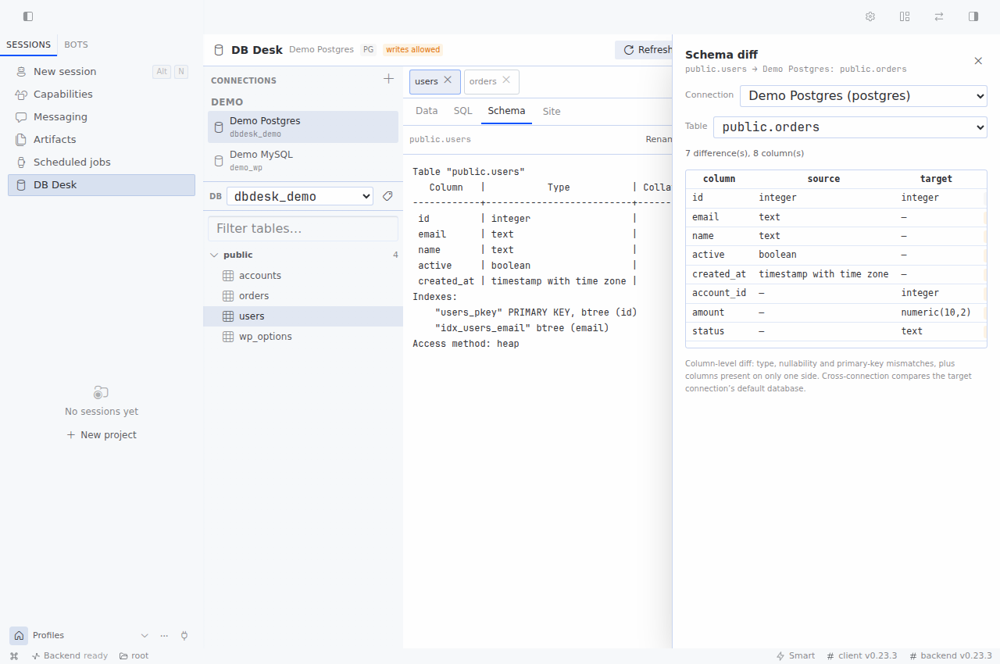

- **+ Column / − Column / Rename** — DDL editor ringkas (nama, type, default,
  nullable). Preview → Execute; grid & DDL refresh.
- **Indexes** — senarai index (PG/MySQL/SQLite), create (unique optional) atau
  drop. Primary key dilindungi. ClickHouse tak support index editing.

  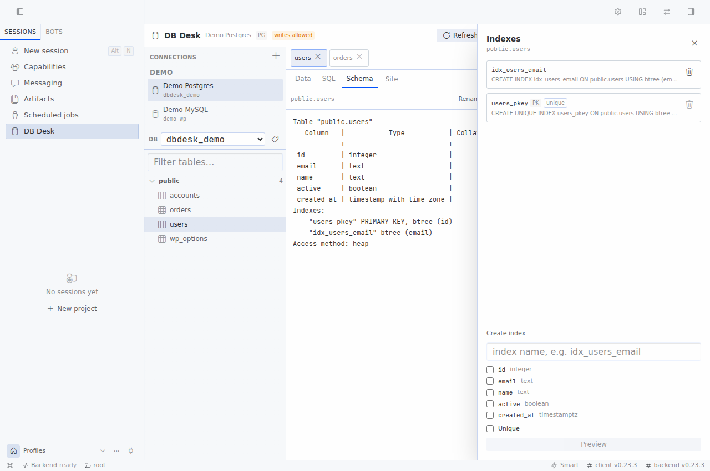

## 6. Import / export

- **Import** (sebelah + Row) — pilih CSV dengan header sama nama column.
  Drawer tunjuk preview 5 row, bilangan row/column, dan checkbox **empty =
  NULL**. Import → preview SQL → Execute. Max 5000 row, batch 200.
- **Export CSV** — export **seluruh table** (server-side, cap 50,000 row).
- Untuk SQLite, import/delete bulk dijalankan satu statement pada satu masa
  dalam satu transaksi (driver stdlib tak terima multi-statement).

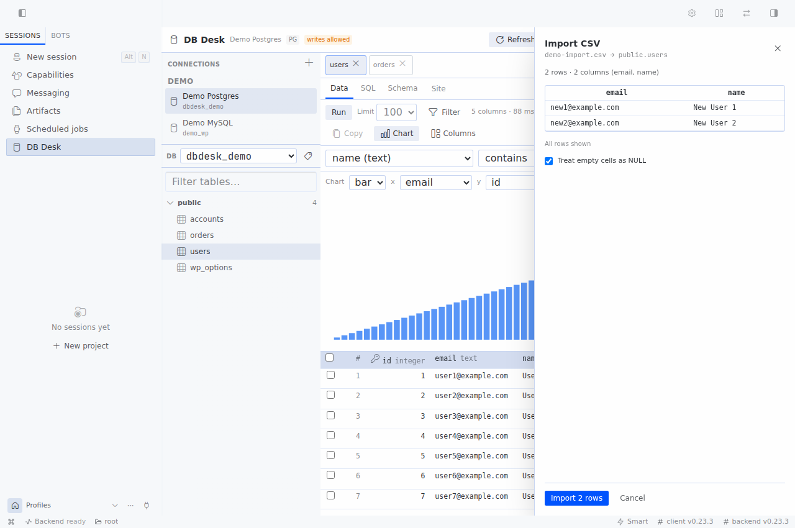

## 7. Production approvals

Write pada connection **PROD**:

1. Preview SQL → tick pengesahan → Execute.
2. DB Desk cipta approval request dan hantar **notis Telegram** dengan link DB
   Desk.
3. Dialog **Waiting for approval** (poll 2s, timeout 5 min). Buka DB Desk pada
   peranti lain → **Approvals** → Approve/Deny, atau tekan **Approve now**.
4. Selepas approve, write dijalankan. Approval terikat pada **hash SQL** yang
   sama dan hanya boleh guna sekali.

Butang **Approvals** di header tunjuk bilangan pending; drawer senarai pending +
recent.

## 8. Audit

Butang **Audit** di header — rekod setiap write yang dijalankan: masa,
connection, action, row, ok/error, SQL. Disimpan dalam
`plugin-data/dbdesk/audit.jsonl` (0600). Write pada connection **PROD** juga
hantar notis Telegram melalui `hermes send` (notis, bukan approval blocking).

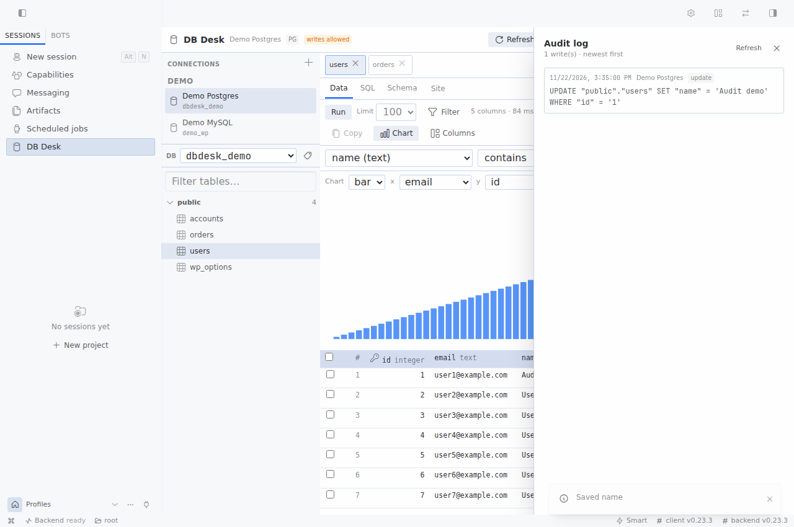

## 9. WordPress Site

Untuk connection MySQL/MariaDB, tab **Site** baca `*options`, `*posts` dan
`*users`:

- site URL / home / nama blog / theme
- bilangan post, page, attachment, user
- senarai active plugins (parsed dari `active_plugins`)

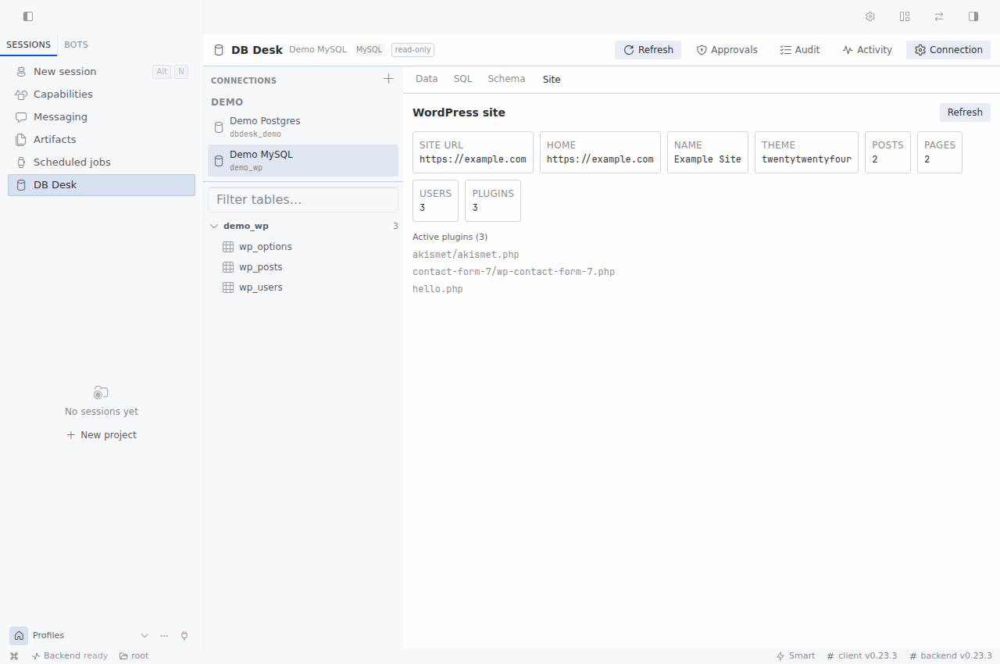

Serialized value (cth `widgets` dalam `wp_options`) boleh **Parse** jadi JSON
yang mudah dibaca, dan **Fix lengths** untuk betulkan `s:N` selepas edit.

## 10. MCP connections

Kalau DB hanya boleh diakses melalui MCP, tambah connection jenis **MCP (query
tool)**:

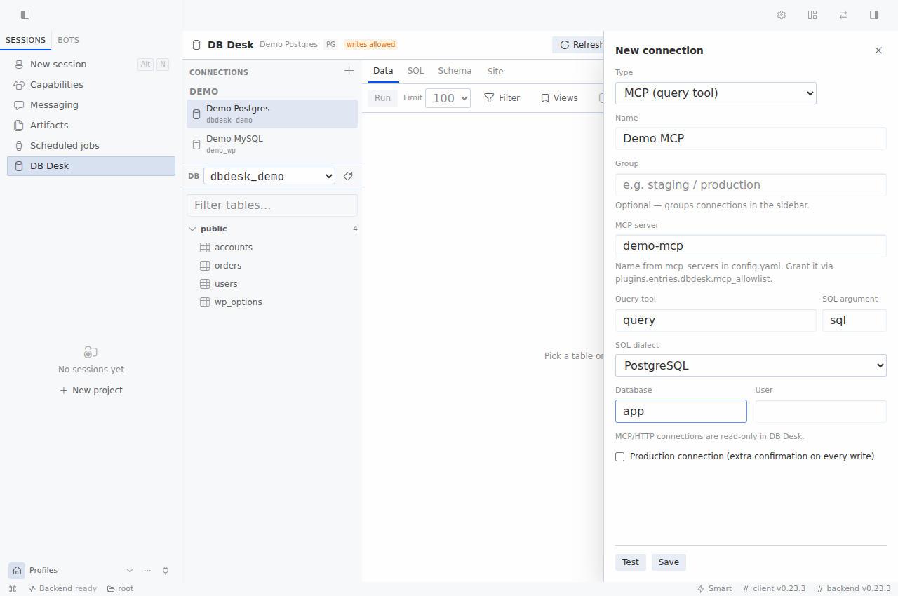

| Field | Nota |
|---|---|
| MCP server | Nama dari `mcp_servers` dalam `config.yaml` |
| Query tool | Tool yang jalankan SQL (cth `query`, `execute_sql`) |
| SQL argument | Nama argumen SQL (cth `sql`, `query`) |
| Dialect | PostgreSQL/MySQL/ClickHouse — untuk metadata & quoting |

Grant akses server (default deny):

```bash
hermes config set plugins.entries.dbdesk.mcp_allowlist '["my-postgres-mcp"]'
```

MCP connection **read-only** dalam DB Desk; schema tree/columns/rows dibina
melalui metadata SQL yang dihantar ke tool yang sama. Kalau tool pulangkan
JSON/list/markdown table, ia diparse; selain itu fallback satu column `result`.

## 11. HTTP query gateway (Cloudflare Zero Trust)

Kalau DB didedahkan melalui HTTP gateway (bukan TCP), tambah connection jenis
**HTTP (query gateway)**:

| Field | Nota |
|---|---|
| Gateway URL | cth `https://db-gw.example.com/query` |
| Method / SQL field | `POST` + `sql`, atau `GET` + param |
| Headers | satu `Name: value` per line |
| Dialect | PostgreSQL/MySQL/ClickHouse |

Contoh headers Cloudflare Access:
```
CF-Access-Client-Id: xxxx.access
CF-Access-Client-Secret: yyyy
```

Response JSON (`{columns, rows}`, `{data: [...]}`), list of objects, markdown
table, atau ClickHouse JSON (`meta` + `data`) akan diparse. HTTP connection
**read-only** dalam DB Desk. Headers disimpan bersama connection (`0600`) —
jangan letak token yang lebih luas daripada read-only.

**ClickHouse Cloud di belakang Cloudflare Access:**

| Field | Nilai |
|---|---|
| Gateway URL | `https://cloud-ch.example.com:8443/?default_format=JSON` |
| Method | `POST` |
| Body | **Raw SQL text** |
| SQL dialect | ClickHouse |
| Headers | `CF-Access-Client-Id` + `CF-Access-Client-Secret` |

Client yang tak boleh hantar custom header (cth sesetengah client PHP) perlukan
nginx shim; DB Desk hantar headers terus ke Cloudflare, jadi shim tak
diperlukan. Guna user ClickHouse read-only.

## 12. Activity

Butang **Activity** di header — senarai sesi server: id, user, db, state,
seconds, query. Refresh automatik 5s.

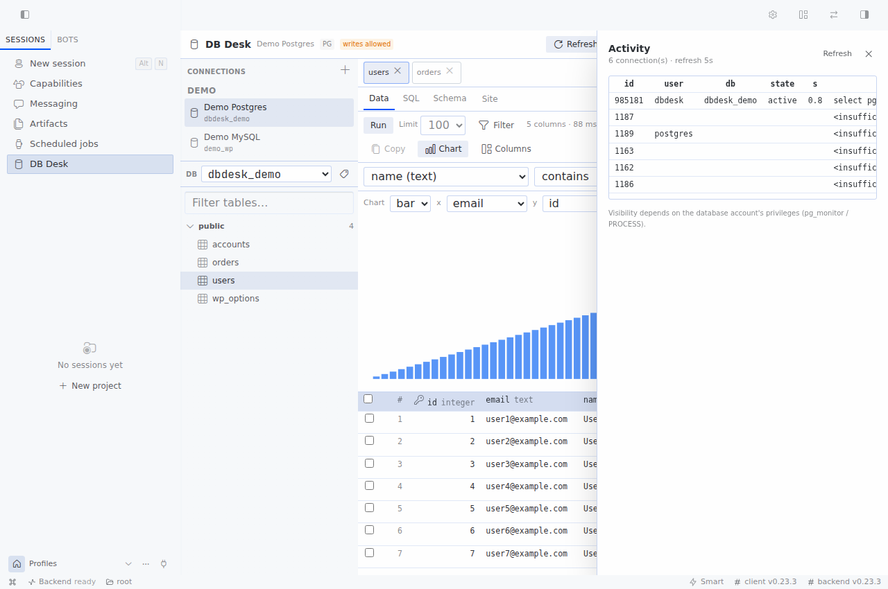

> Visibility ikut privilege akaun: PostgreSQL perlukan `pg_monitor` untuk nampak
> semua query; MySQL perlukan `PROCESS`. Tanpanya, hanya sesi sendiri yang
> kelihatan.

## 13. Mobile

Sidebar jadi overlay (☰), drawer full-width, toolbar wrap, grid scroll sendiri.
Long-press cell buka menu **Edit / Copy value / Copy row / Follow FK**.

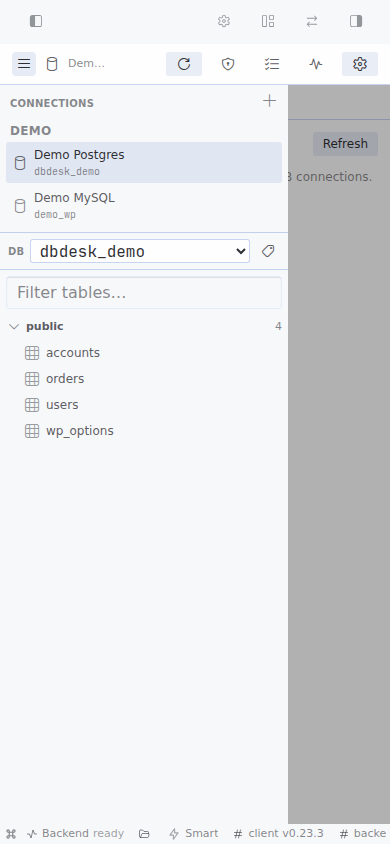
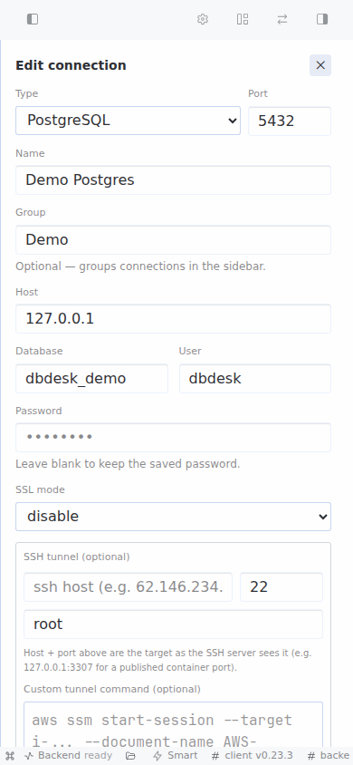

## 14. AI chat (multi-database)

Butang **AI** di header buka chat di kanan. Ia guna endpoint OpenAI-compatible
(base URL + model + API key dalam **Settings / AI settings**) dan menjalankan
SQL read-only sahaja.

- **Scope bar** di bawah header: default **All databases** (semua connection
  yang AI-enabled). Boleh pilih subset, **Current only** atau **None**.
- **Soalan merentas DB**: agent minta schema yang belum dilihat, kemudian
  pulangkan satu statement read-only per DB (max 3) + join SQL. DB Desk
  jalankan setiap statement pada DB asalnya, muat result ke SQLite in-memory
  dan buat join **secara lokal**. Hanya schema, SQL, row count dan error pergi
  ke provider — **rows tak pernah dihantar**.
- Setiap jawapan tunjuk blok SQL per source (**Copy SQL**, atau **Open in SQL**
  untuk connection semasa), blok **Local join**, jadual gabungan dan log langkah.
- **Follow-up** kekal dalam thread (SQL/penjelasan sebelum ini dihantar).
- Sapaan/non-data dibalas terus tanpa SQL.
- **Switch per connection** dalam form connection:
  - **AI can see this schema** — off: connection tersembunyi dari agent.
  - **AI can run read-only queries** — off: inspect-only (agent boleh lihat
    schema, tak boleh query).
- Statement agent masuk **audit log** (`ai_read`).

## 15. Agent tools

Plugin daftar dua tool read-only untuk agent:

| Tool | Guna |
|---|---|
| `db_connections` | Senarai connection (id, name, kind, database, readonly, production, ssh) — tiada secret |
| `db_query` | `connection_id`, `sql`, `limit` — SELECT/WITH/SHOW/EXPLAIN sahaja, max 200 row |

Toolset `dbdesk` perlu ada dalam `platform_toolsets` (cli/telegram). Agent
guna connection yang sama, termasuk SSH tunnel dan vault decrypt.

## 15b. Structure grid & filters

- Tab **Schema** kini papar structure grid: `#`, column, type, charset,
  collation, nullable, default, extra, foreign key, comment, plus grid index
  (`index_name`, algorithm, unique, column). DDL ada pada butang **DDL**.
- Panel **Filter** ialah senarai: setiap baris ada checkbox, column/operator/
  value, **Apply**, remove. **Apply all** hidupkan semua; hanya baris yang
  bertanda dihantar dalam WHERE. Tekan **Enter** pada satu baris untuk apply
  baris itu (yang lain kekal ikut checkbox). Saved view simpan flag enabled.

## 15b-2. Generate SQL from filters

Panel **Filter** ada butang **SQL** (dan toolbar Data juga). Ia jana
`SELECT * FROM schema.table` dengan WHERE, ORDER BY dan LIMIT semasa — hanya
filter yang bertanda. Preview muncul: **Copy** atau **Open in SQL**. Quoting
dan escaping ikut dialect (Postgres/MySQL/ClickHouse/SQLite).

## 15c. ClickHouse + Cloudflare Access

ClickHouse guna HTTP interface, jadi Zero Trust app boleh terus connect:

1. Cloudflare Zero Trust → **Access → Service Auth** → cipta service token.
2. Connection: host = hostname awam, port `443`, SSL mode `require`.
3. **HTTP path** jika endpoint di subpath (default `/`).
4. **Custom HTTP headers** — satu baris satu header:

   ```
   CF-Access-Client-Id: <id>.access
   CF-Access-Client-Secret: <secret>
   ```

Headers disimpan AES-GCM, tidak dipulangkan ke UI/AI, dan hanya masuk
export/backup bila **Include passwords** ditick.

## 16. Keselamatan

- Password **AES-GCM** dalam `plugin-data/dbdesk/connections.json`; key dalam
  `vault.key` (0600). Kedua-dua tak dihantar ke UI.
- **Read-only** default; backend enforce (`default_transaction_read_only` /
  `tx_read_only` / `readonly=1`).
- **Production** flag + sensitive-table warning untuk `wp_options`, `wp_users`,
  `users`, `accounts`, `subscriptions`.
- Ini guardrail, bukan sandbox — sesiapa dengan akses webapp + connection boleh
  query DB yang dibenarkan.

## 17. Test

```bash
./tests/run.sh
# atau
PYTHON=/path/to/python HERMES_ROOT=/usr/local/lib/hermes-agent ./tests/run.sh
```

70 test backend/agent (helper SQL, vault, migration, builders, endpoint
preview/guard, query/views, agent tools). Tiada DB server diperlukan — dialect
dimock, storage guna temp home.

## 18. Troubleshooting

| Masalah | Semak |
|---|---|
| Page tak muncul | Reload tab / ⌘K → Reload desktop plugins; pastikan plugin UI half enabled |
| SSH tunnel gagal | Key auth (`ssh root@host`), host key, dan `host:port` mesti boleh dicapai **dari server SSH** |
| Activity kosong | Akaun tiada `pg_monitor` / `PROCESS` |
| Import “Unknown column” | Header CSV mesti sama dengan nama column table |
| MCP 403 | Tambah server ke `plugins.entries.dbdesk.mcp_allowlist` |
| Tunnel tak buka | Uji command tu manual; pastikan ia dengar `Host:Port` yang diisi |
| HTTP 403/302 | Cloudflare Access — semak header service token; 302 biasanya login redirect |
| MCP result satu column | Tool pulangkan teks bebas; guna tool yang pulangkan JSON/rows |
| Write ditolak | Read-only ON, connection PROD belum di-ack, atau approval belum dibuat |
| Approval timeout | Approve dalam DB Desk → Approvals (atau Approve now) dalam 5 minit |
| Chart kosong | Tiada column numeric dalam result |
